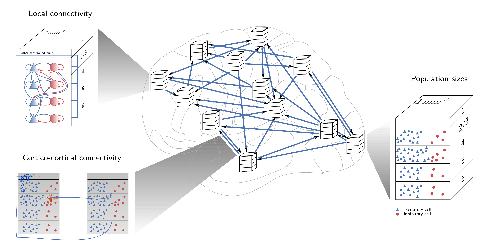

# From Vision to Action: A Mesoscopic Network Model of the Macaque Visuo-Motor System

[](https://www.python.org)
[](https://www.nest-simulator.org/)
<!-- TODO: add the license badge once you have chosen a license -->

<!-- TODO: add a overview figure of the model, for example:
 -->

A stochastic, population-level simulation of **43 macaque cortical areas** spanning visual, parietal, premotor and motor cortex. It is built in [NEST](https://www.nest-simulator.org/) with the [`gif_pop_psc_exp`](https://nest-simulator.readthedocs.io/en/stable/models/gif_pop_psc_exp.html) mesoscopic population model.

This repository accompanies the Master's thesis *"From Vision to Action: A Mesoscopic Network Model of the Macaque Visuo-Motor System"* (Gaurav Sapkal, University of Cologne, 2026). The work was carried out in collaboration with Forschungszentrum Jülich.

---

## Table of contents

1. [Scientific question](#scientific-question)
2. [Why a mesoscopic model?](#why-a-mesoscopic-model)
3. [The model in brief](#the-model-in-brief)
4. [Repository structure](#repository-structure)
5. [Installation](#installation)
6. [Quick start](#quick-start)
7. [Python framework](#python-framework)
8. [Parameters](#parameters)
9. [Output](#output)
10. [Analysis and plots](#analysis-and-plots)
11. [Data pipeline](#data-pipeline)
12. [Relation to the multi-area spiking model](#relation-to-the-multi-area-spiking-model)
13. [Requirements](#requirements)
14. [Citation](#citation)
15. [Acknowledgements and contact](#acknowledgements-and-contact)

---

## Scientific question

> How does anatomically constrained connectivity within the visuo-motor system shape its emergent resting-state dynamics?

The model extends the multi-area spiking model of macaque visual cortex ([Schmidt et al., 2018](https://doi.org/10.1371/journal.pcbi.1006359)) with seven motor and premotor areas (F1–F7). It asks whether realistic spontaneous activity and oscillations can emerge from shared microcircuit principles, **without area-specific tuning**.

---

## Why a mesoscopic model?

| Level | Strength | Limitation |
|---|---|---|
| Microscopic (spiking neurons) | Individual spikes, neuron-level detail | Too costly for dozens of areas and many parameters |
| Macroscopic (rate / neural-mass) | Fast, large-scale | Spike history and finite-size fluctuations are lost or added ad hoc |
| **Mesoscopic (this work)** | Keeps refractoriness, spike-history dependence, finite-size noise and delayed E–I interactions | Output is population activity, not single-neuron spikes |

Each node represents a **finite population of similar neurons**. Instead of simulating every neuron, a node evolves the population activity, the number of spikes of the population in each time step, as a stochastic process. The activity in a step is drawn from the firing probability of the population, given its own spike history (refractoriness) and its synaptic input. Because the number of neurons \(N\) is finite, the activity fluctuates around its mean, and these fluctuations are part of the dynamics. The underlying neurons are generalized integrate-and-fire neurons with the escape rate

$$h(t) = \rho_0 \exp\ \left(\frac{V(t) - V_T^{*}}{\Delta V}\right),$$


where $(\rho_0)$ is the rate at threshold and $(\Delta V)$ the softness of the threshold. The population equations follow [Schwalger, Deger & Gerstner (2017)](https://doi.org/10.1371/journal.pcbi.1005507) and are implemented in [NEST](http://www.scholarpedia.org/article/NEST_(NEural_Simulation_Tool)) as `gif_pop_psc_exp`.

---

## The model in brief



- **43 areas**: 36 visual, parietal and temporal areas, plus the motor and premotor areas F1–F7.
- **8 populations per area**: 23E, 23I, 4E, 4I, 5E, 5I, 6E, 6I, so **344 populations** and 344 NEST nodes.
- **Population sizes** are the neuron numbers of a 1 mm² patch of each area.
- **Connectivity** is one connection per pair of populations (344 × 344). Its weight is the synaptic weight times the connection probability (mean-field connectivity), because a `gif_pop_psc_exp` node receives the summed spikes of the whole source population. Cortico-cortical weights can be scaled with `cc_weights_factor`. The weight from 4E to 23E inside an area is doubled, as in the multi-area model.
- **Delays**: 1.5 ms (from E) and 0.75 ms (from I) inside an area. Between areas the delay is the distance divided by a conduction speed (3.5 mm/ms by default).
- **External input**: each population receives a constant current whose mean follows from its external indegree, the synaptic strength and the rate of the external input equal to 10 Hz.


---

## Repository structure

```
VM_MAM_models/
├── visuomotor_data/                    Importing anatomical data and its processing
│   ├── Visuomotor_Data.py              raw data -> visuomotor_raw_data.json
│   ├── Visuomotor_Data_Processing.py   -> visuomotor_processed_data.json
│   ├── Visuomotor_Model.py             -> model parameters and connectivity
│   ├── Visuomotor_Diagnostics.py       diagnostics and connectivity plots
│   └── raw_data/                       raw input files
└── Mesoscopic_visuomotor_mam/          the mesoscopic visuo-motor model
    ├── mesoscopic_vm_interface.ipynb   notebook: build, simulate, analyse
    ├── config.py                       paths
    ├── default_params.py               all default parameters
    ├── prepare_data.py                 creates missing data files
    ├── external_input.py               Calculated mean external input (mu) for every population
    ├── mesoscopic_model.py             model class
    ├── simulation.py                   NEST network and simulation
    ├── analysis.py                     analysis class
    ├── analysis_helpers.py             bursts, band power, logs
    ├── plotting.py                     plots
    ├── theory.py                       fixed points of the rate equations (Not used)
    ├── run_simulation.py               command-line runner
    └── simulations/                    one folder per simulation (created)
```


---

## Installation

1. Install [NEST 3.x](https://nest-simulator.readthedocs.io/en/stable/installation/index.html) with Python bindings. NEST must be installed separately; it is not available through `pip`.
2. Clone the repository and install the Python packages:

   ```bash
   git clone <URL-of-this-repository>
   cd <repository>
   pip install numpy scipy pandas matplotlib seaborn nested_dict
   ```

3. Optional packages for the burstiness analysis: `hmmlearn` (hidden Markov model) and `diptest` (test for bimodality).

The code was developed with Python 3.11. Check that `import nest` works in the environment you use for the notebook.

---

## Quick start

### With the notebook

1. Open `Mesoscopic_visuomotor_mam/mesoscopic_vm_interface.ipynb` in the environment that has NEST.
2. Set the parameters in the parameter cell (`g`, `cc_weights_factor`, `rho_0`, `Delta_V`, simulation time, seed, areas).
3. Run the cells in order. The first run builds the data files that are missing (see [Data pipeline](#data-pipeline)).

### In Python

```python
from mesoscopic_model import Mesoscopic_Visuomotor_Model
from analysis import Analysis

network_spec = {'connection_params': {'g': -14., 'cc_weights_factor': 1.}}
sim_spec = {'sim_time_ms': 700., 'rng_seed': 4}

M = Mesoscopic_Visuomotor_Model(network_spec=network_spec,
                                simulation=True, sim_spec=sim_spec)
M.simulation.simulate()

A = Analysis(M, M.simulation)
A.plot_mean_rates()
```

### From the command line

```bash
cd Mesoscopic_visuomotor_mam
python run_simulation.py --g -14 --seed 4 --sim-time 700
```

If a simulation with the same parameters has already been run, its result is loaded from `simulations/`. Use `--force` (or `simulate(force=True)`) to simulate again.

---

## Python framework

| Class | Task |
|---|---|
| `Mesoscopic_Visuomotor_Model` | Loads the data, creates missing data files, computes synaptic weights, delays and external input. It holds all information about the network structure. |
| `Simulation` | Created by the model. It builds the NEST network (one `gif_pop_psc_exp` node per population, one connection per pair), places a multimeter and a spike recorder at every node, simulates and stores the results. |
| `Analysis` | Loads the results of a simulation (or of an earlier run by its label) and provides the analyses and plots. |

Network structure (`network_params`), simulation (`sim_params`) and analysis (`analysis_params`) are kept separate. Custom values are given as partial, nested dictionaries and merged into the defaults of `default_params.py`. Unknown keys raise an error.

---

## Parameters

The most important parameters:

| Parameter | Default | Meaning |
|---|---|---|
| `g` | −14 | Relative strength of inhibition |
| `cc_weights_factor` | 1 | Scaling of the cortico-cortical weights |
| `rho_0` (Hz) | 10 | Rate at threshold of the population neurons |
| `Delta_V` (mV) | 5 | Softness of the threshold |
| `interarea_speed` (mm/ms) | 3.5 | Conduction speed between areas |
| `areas_simulated` | all 43 | List of areas to simulate |
| `sim_time_ms` | 700 | Simulated time |
| `transient_ms` | 100 | Initial part excluded from the mean rates |
| `resolution` (ms) | 0.1 | NEST time step |
| `record_interval_ms` | 1 | Sampling interval of the recorders |
| `rng_seed` | 456123 | Seed of the random numbers |
| `local_num_threads` | 4 | NEST threads |

The full list is in `Mesoscopic_visuomotor_mam/default_params.py`. A change of any parameter gives a new simulation label.

---

## Output

Each simulation has its own folder `simulations/<label>/`:

| File | Content |
|---|---|
| `params.json` | Network and simulation parameters |
| `results.npz` | Rate time series and mean rates of every population |
| `summary.json` | Mean rates of all populations |
| `figures/` | Figures created by the `Analysis` class |

The results of a population are `rate_from_spikes` (from the spike recorder), `rate_from_mean` (from the multimeter), their time axes and the mean rates after the transient.

---

## Analysis and plots

| Analysis | Method of `Analysis` |
|---|---|
| Mean rates of all populations (heat map) | `plot_mean_rates` |
| Rates per population across areas (box or bar plot) | `plot_population_rates` |
| Rate traces and population activity | `plot_rate_dynamics`, `plot_population_activity` |
| Activity of the whole network | `plot_activity_heatmap` |
| Burstiness | `burstiness`, `plot_burstiness` |
| Power spectra and beta power | `plot_power_spectrum`, `plot_beta_power` |
| Fixed points of the rate equations | `fixed_points` |

Connectivity plots (binary symmetric connectivity, FLN, SLN, connection probability) are in `visuomotor_data/Visuomotor_Diagnostics.py`.

---

## Data pipeline

The anatomical data is processed in steps. Each step writes a json file to `visuomotor_data/`:

| Step | Function | Output |
|---|---|---|
| 1 | `Visuomotor_Data.process_raw_data()` | `visuomotor_raw_data.json` |
| 2 | `Visuomotor_Data_Processing.process_data()` | `visuomotor_processed_data.json` |
| 3 | `Visuomotor_Model.compute_Model_params()` | `visuomotor_Data_Model.json` |
| 4 | `Visuomotor_Model.compute_connectivity_files()` | `visuomotor_connection_prob_data.json`, `visuomotor_indegree_data.json` |
| 5 | `external_input.build_mean_input_file()` | `mu_values.json` |

`prepare_data.py` runs every step whose output file is missing when the model is created, and never overwrites existing files. To rebuild a file, delete it and all files after it.

<!-- TODO: describe the raw data sources (Markov et al., CoCoMac, ...) and where raw_data/ comes from. -->

---

## Relation to the multi-area spiking model

The model builds on the multi-area model of macaque visual cortex (Schmidt et al., 2018). The main differences are:

| | Multi-area spiking model | This model |
|---|---|---|
| Unit | Individual spiking neurons | Populations (`gif_pop_psc_exp`) |
| Areas | 32 visual areas | 43 areas, including F1–F7 |
| Connections | Many synapses between neurons | One connection per pair of populations, weight includes the connection probability |
| Output | Spikes | Population activity |
| Cost | Large compute resources | A single machine |

---

## Requirements

- Python 3.11 (earlier Python 3 versions are likely to work)
- NEST 3.x with the `gif_pop_psc_exp` model
- numpy, scipy, pandas, matplotlib, seaborn, nested_dict
- Optional: hmmlearn, diptest

---

## Citation

If you use this code, please cite the thesis and the papers it builds on:

```bibtex
@mastersthesis{sapkal2026visionaction,
  author = {Sapkal, Gaurav},
  title  = {From Vision to Action: A Mesoscopic Network Model of the Macaque Visuo-Motor System},
  school = {University of Cologne},
  year   = {2026}
}
```

1. Schwalger T, Deger M, Gerstner W (2017). Towards a theory of cortical columns: From spiking neurons to interacting neural populations of finite size. *PLoS Computational Biology* 13(4): e1005507. [doi:10.1371/journal.pcbi.1005507](https://doi.org/10.1371/journal.pcbi.1005507)
2. Schmidt M, Bakker R, Hilgetag CC, Diesmann M, van Albada SJ (2018). Multi-scale account of the network structure of macaque visual cortex. *Brain Structure and Function* 223: 1409. [doi:10.1007/s00429-017-1554-4](https://doi.org/10.1007/s00429-017-1554-4)
3. Schmidt M, Bakker R, Shen K, Bezgin G, Diesmann M, van Albada SJ (2018). A multi-scale layer-resolved spiking network model of resting-state dynamics in macaque cortex. *PLoS Computational Biology* 14(9): e1006359. [doi:10.1371/journal.pcbi.1006359](https://doi.org/10.1371/journal.pcbi.1006359)

---

## Acknowledgements and contact

This work was carried out in collaboration with Forschungszentrum Jülich.
<!-- TODO: add supervisors, funding, and the license -->

Questions about the code or the science: please open an issue on GitHub or contact Gaurav Sapkal (<!-- TODO: e-mail -->).
